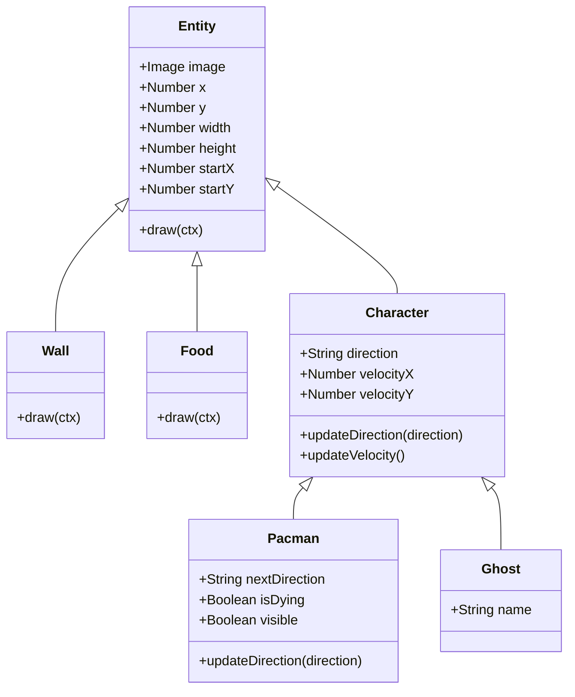
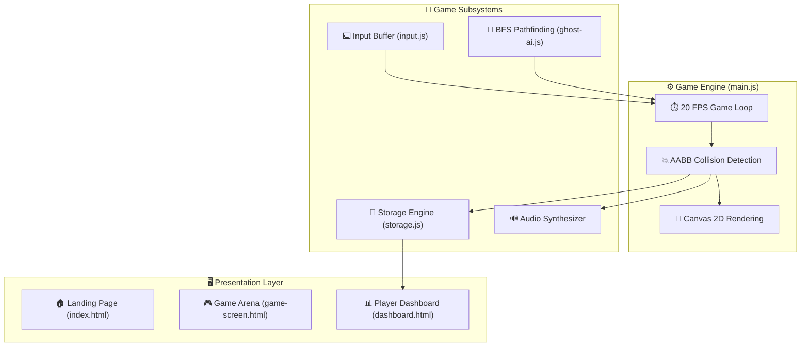

<div align="center">

# 🕹️ PAC-MAN ARCADE CLASSIC 🕹️

### ⚡ *Chase the Dots • Outsmart the Ghosts • Claim the High Score* ⚡

[](file:///home/ritish/project/pacman/scripts/game/main.js)
[](file:///home/ritish/project/pacman/pages/game-screen.html)
[](file:///home/ritish/project/pacman/styles/pacman.css)
[](file:///home/ritish/project/pacman/scripts/dashboard.js)
[](file:///home/ritish/project/pacman/scripts/game/storage.js)
[](file:///home/ritish/project/pacman/README.md#license)

<br/>

```
  🟡 · · · · · ᗧ · · · · · 👻 👻 👻 👻 · · · · · 🍒
```

<p align="center">
  A browser-native recreation of the golden-age 80s arcade phenomenon built with modular Vanilla JavaScript, HTML5 Canvas 2D, and retro-futuristic CSS. Features BFS ghost pathfinding intelligence, a 3-life heart counter, death animation effects, tunnel wrapping, and a cyberpunk player analytics dashboard.
</p>

</div>

---

## 🌟 Key Highlights & Features

| Feature | Icon | Description |
|:---|:---:|:---|
| **Authentic Maze Engine** | 🗺️ | 21×19 tile grid with 40px tiles, smooth sprite transformations, and corridor navigation. |
| **BFS Ghost Intelligence** | 🧠 | Breadth-First Search shortest path algorithm navigating corridors and tunnels toward Pac-Man. |
| **Lives & Damage State** | ❤️ | 3-life counter with visual heart icons, death blinking effect, and seamless board reload. |
| **Tunnel Wrapping** | 🌀 | Screen-edge warp tunnels (Row 9) enabling tactical escape routes for Pac-Man and ghosts. |
| **Interactive Game Over** | 💀 | Dedicated modal overlay displaying final run score with instantaneous "Play Again" restart. |
| **Player Analytics Suite** | 📊 | Bento-style dashboard featuring Chart.js line charts, win rate doughnuts, and encounter bars. |
| **Behavioral Profiler** | 🎯 | Calculates playstyle (*Aggressive 🔥* vs *Cautious 🛡️*), avoidance rates, efficiency, and streaks. |
| **Audio Soundscape** | 🎵 | Retro background music, dynamic eating dot sound loops, failure audio, and global mute toggles. |

---

## 📁 Project Directory Structure

```
pacman/
├── 📄 index.html                   # 🏠 Arcade landing page (hero, ghosts, controls & BGM)
├── 📁 pages/
│   ├── 📊 dashboard.html           # 📈 Player stats, Chart.js visualizations & match history
│   └── 🕹️ game-screen.html         # 🎮 HTML5 Canvas game board, HUD & Game Over overlay
├── 📁 scripts/
│   ├── 📊 dashboard.js             # 🧮 Stats computation, Chart.js graphs & history table
│   ├── 🎵 index.js                 # 🔊 Landing page background music player
│   └── 📁 game/
│       ├── 🧱 classes.js           # 🏛️ OOP Entity hierarchy & AABB collision detection
│       ├── 🧠 ghost-ai.js          # 🤖 BFS pathfinding & intersection decision engine
│       ├── ⌨️ input.js              # 🎮 Keyboard event handlers & direction buffering
│       ├── ⚙️ main.js              # 🔄 Core 20 FPS game loop, rendering & audio triggers
│       └── 💾 storage.js           # 📦 LocalStorage history & cumulative metrics manager
├── 📁 styles/
│   ├── 🎨 dashboard.css            # 💻 Cyberpunk bento-grid, widgets & tooltips
│   └── 🕹️ pacman.css               # 👾 Shared 80s neon design system & HUD typography
└── 📁 assets/
    ├── 🎵 audio/                   # 🎧 Sound effects & audio tracks
    │   ├── 💥 fail.mp3
    │   ├── 👻 ghost - normal-move.mp3
    │   ├── ⚡ ghost-spurt-move-#1.mp3 to #4.mp3
    │   ├── 🟡 pacman-eating-food-dots.mp3
    │   └── 🎶 start-music.mp3
    └── 🖼️ images/                  # 👾 Directional sprites, icons & textures
        ├── 🩵 blueGhost.png
        ├── 🍒 cherry.png & cherry2.png
        ├── ❤️ heart.png
        ├── 🖼️ hero-banner.png
        ├── 🧡 orangeGhost.png
        ├── ᗧ pacmanUp.png, pacmanDown.png, pacmanLeft.png, pacmanRight.png
        ├── 🩷 pinkGhost.png
        ├── ❤️ redGhost.png
        ├── 😨 scaredGhost.png
        └── 🧱 wall.png
```

---

## 🏗️ Architecture & System Design

### 🏛️ Class Hierarchy Diagram

The codebase utilizes clean Object-Oriented inheritance rooted in `Entity`:



### ⚙️ System Flow Architecture



---

## 🧠 Ghost AI & Pathfinding Algorithm

Ghosts make real-time navigational decisions using a dual-phase pathfinding engine:

```
[Ghost at Tile Boundary] ──► [Run BFS shortest path to Pac-Man]
                                       │
                    ┌──────────────────┴──────────────────┐
                    ▼                                     ▼
            [Path Identified]                     [Dead End / No Path]
                    │                                     │
         Take Optimal Next Turn                  Evaluate Valid Non-Reversing
         (Preventing 180° flips)                 Random Intersections
```

- **BFS Shortest Path (`findShotestPath`)**: Searches neighboring tiles `[U, D, L, R]` while observing maze wall collisions (`X`) and tunnel wrapping coordinates on row 9 (`tunnelRow = 9`).
- **Intersection Decision Engine (`getGhostDirections`)**: Evaluates valid branch points whenever a ghost hits tile boundaries (`x % tileSize === 0` and `y % tileSize === 0`), rejecting immediate reversal turns unless boxed in.

---

## 👾 The Ghost Squad Dossier

| Ghost | Alias | Color | Profile & AI Tactics |
|:---:|:---:|:---:|:---|
| 🔴 | **Blinky** | Crimson Red | **The Hunter** — Employs aggressive BFS pursuit targeting Pac-Man's exact coordinates. |
| 🩷 | **Pinky** | Neon Pink | **The Ambusher** — Traverses corridors to intercept escape routes at intersections. |
| 🩵 | **Inky** | Electric Cyan | **The Tactician** — Patrols open maze alleys, flanking when paths converge. |
| 🧡 | **Clyde** | Radiant Orange | **The Wildcard** — Roams freely between corners, breaking pursuit unpredictably. |

---

## 📊 Player Dashboard & Behavioral Analytics

The dashboard extracts data from `localStorage` (`pacmanHistory` & `pacmanStats`) to build a comprehensive player profile:

<div align="center">

| Metric Card | Metric ID | Calculation / Purpose |
|:---|:---:|:---|
| 🏆 **All-Time High Score** | `highScore` | Maximum single-session score recorded. |
| 🎮 **Games Played** | `gamesPlayed` | Total completed game sessions logged (up to 50). |
| 📊 **Average Score** | `avgScore` | `totalScore / gamePlayed` across logged sessions. |
| 🍒 **Total Food Eaten** | `totalFood` | Lifetime count of dots collected. |
| 👻 **Ghost Encounters** | `totalGhosts` | Lifetime collision events with ghosts. |
| 📈 **Improvement Trend** | `trendValue` | Compares recent 5-game average score against prior 5 games. |
| 🔥 **Play Style** | `playStyle` | Classifies as **Aggressive 🔥** (>1.5 hits/game) or **Cautious 🛡️**. |
| 🛡️ **Ghost Avoidance** | `avoidanceRate` | Percentage of games finished with zero ghost collisions. |
| ⚡ **Efficiency Rating** | `efficiencyRating` | Ratio of dots gathered per ghost hit (`totalFood / ghostHits`). |
| 🏅 **Best Streak** | `bestStreak` | Maximum consecutive games won without dying. |

</div>

### 📈 Interactive Charts (Chart.js)
1. **Score Progress Line Chart**: Visualizes score trajectory over the previous matches with yellow neon glow fills.
2. **Win Rate Doughnut Chart**: Interactive percentage display comparing clear board victories against defeats.
3. **Ghost Encounters Bar Chart**: Per-game bar chart tracking mistakes and encounter frequency.

---

## ⌨️ Controls & Keybindings

| Action | Primary Key | Alternate Key | Function |
|:---|:---:|:---:|:---|
| **Move Up** | <kbd>W</kbd> | <kbd>↑</kbd> | Directs Pac-Man upward (buffers until lane clears) |
| **Move Down** | <kbd>S</kbd> | <kbd>↓</kbd> | Directs Pac-Man downward (buffers until lane clears) |
| **Move Left** | <kbd>A</kbd> | <kbd>←</kbd> | Directs Pac-Man leftward (buffers until lane clears) |
| **Move Right** | <kbd>D</kbd> | <kbd>→</kbd> | Directs Pac-Man rightward (buffers until lane clears) |
| **Mute Game Audio** | Sound Button (HUD) | — | Toggles in-game sound effects |
| **Mute Landing BGM** | BGM Button (Nav) | — | Toggles arcade 80s intro music |

> 💡 **PRO TIP:** Pac-Man buffers your directional inputs! If you press a turn key slightly before reaching an opening, Pac-Man will automatically make the turn as soon as the corridor opens.

---

## 🚀 Quickstart & Setup Guide

### 📋 Prerequisites
Any modern browser (Chrome, Chromium, Firefox, Safari, Edge) with HTML5 Canvas and JavaScript enabled.

### 💻 Local Run Instructions

1. **Clone the repository**:
   ```bash
   git clone https://github.com/RITISHM/pacman.git
   cd pacman
   ```

2. **Launch a lightweight local server**:
   ```bash
   # Using npx (Node.js):
   npx serve .

   # Or using Python 3:
   python3 -m http.server 3000
   ```

3. **Open the game**:
   ```text
   http://localhost:3000/
   ```

4. **Insert Coin**: Click **"INSERT COIN - PLAY NOW"** to launch into the arcade!

---

## 🛠️ Technology Stack & Tooling

<div align="center">

| Technology | Category | Role |
|:---|:---|:---|
|  | Core Markup | Semantic HTML5 structure & `<canvas>` 2D context |
|  | Styling | Custom CSS variables, flexbox, Bento grid & neon glow effects |
|  | Game Logic | OOP classes, collision algorithms, state machine & event handlers |
|  | Data Visualization | Real-time charts for player score, win rate, and encounters |
|  | Typography | *Press Start 2P*, *Outfit*, and *Inter* retro fonts |

</div>

---

## 🌐 Browser APIs Used

This project is built entirely on native browser-provided APIs — no runtime dependencies or bundlers required. Here is a complete map of every Web API in use:

---

### 🖼️ Canvas API
> **Used in**: [`main.js`](file:///home/ritish/project/pacman/scripts/game/main.js) · [`game-screen.html`](file:///home/ritish/project/pacman/pages/game-screen.html)

The HTML5 2D Canvas API powers all real-time game rendering — walls, ghosts, Pac-Man, and food dots are drawn every frame onto a `760×840` pixel canvas element.

| Method / Property | Purpose |
|:---|:---|
| `canvas.getContext("2d")` | Acquires the 2D rendering context |
| `ctx.clearRect(0, 0, w, h)` | Clears the full board each frame before redrawing |
| `ctx.drawImage(image, x, y, w, h)` | Renders sprite images (Pac-Man, ghosts, walls) at tile positions |
| `ctx.fillStyle` | Sets the fill colour for dot rendering (`"yellow"`) |
| `ctx.fillRect(x, y, w, h)` | Draws each food dot as a 4×4 px filled rectangle |
| `canvas.width` / `canvas.height` | Programmatically sets board dimensions at initialisation |

```js
// main.js — acquiring context and drawing a sprite
context = board.getContext("2d");
context.drawImage(pacman.image, pacman.x, pacman.y, pacman.width, pacman.height);
```

---

### 🎵 Web Audio API — `HTMLAudioElement`
> **Used in**: [`main.js`](file:///home/ritish/project/pacman/scripts/game/main.js) · [`index.js`](file:///home/ritish/project/pacman/scripts/index.js) · [`game-screen.html`](file:///home/ritish/project/pacman/pages/game-screen.html)

All audio is handled via `new Audio()` which creates `HTMLAudioElement` instances, a subset of the HTML Media Element interface.

| Method / Property | Purpose |
|:---|:---|
| `new Audio(src)` | Creates a playable audio object from a file path |
| `audio.play()` | Returns a `Promise` — resolves when playback starts |
| `audio.pause()` | Immediately pauses audio playback |
| `audio.loop = true` | Enables seamless looping (eating sound, BGM) |
| `audio.muted` | Boolean flag for global sound toggle without stopping audio |
| `audio.currentTime = 0` | Resets track position to beginning on stop |
| `audio.paused` | Checked each frame to guard against double-play calls |

```js
// main.js — dynamic looping eat sound tied to dot collisions
eatSound = new Audio("/assets/audio/pacman-eating-food-dots.mp3");
eatSound.loop = true;
eatSound.play().catch(err => console.log("Audio error:", err));
```

---

### 🖼️ HTMLImageElement API
> **Used in**: [`main.js`](file:///home/ritish/project/pacman/scripts/game/main.js)

Sprite images for Pac-Man, ghosts, walls, and hearts are loaded using the `Image` constructor, then passed into canvas `drawImage()` calls.

| Method / Property | Purpose |
|:---|:---|
| `new Image()` | Creates a programmatic image element |
| `image.src` | Triggers the browser to fetch the image asset from `/assets/images/` |

```js
// main.js — loading ghost sprites
redGhostImage = new Image();
redGhostImage.src = "/assets/images/redGhost.png";
```

> **9 Image objects** are created per game init: `wall`, `blueGhost`, `redGhost`, `pinkGhost`, `orangeGhost`, `pacmanUp`, `pacmanDown`, `pacmanLeft`, `pacmanRight`.

---

### ⏱️ Timer API — `setTimeout`
> **Used in**: [`main.js`](file:///home/ritish/project/pacman/scripts/game/main.js)

The game loop and all timed delays are driven by `setTimeout`. This includes the main animation tick, post-respawn freeze periods, and win/death state transitions.

| Call Site | Delay | Purpose |
|:---|:---:|:---|
| `setTimeout(update, 1000 / 20)` | 50ms | Drives the **20 FPS** recursive game loop |
| `setTimeout(() => { wait = false }, 2000)` | 2000ms | Freeze window on full map reload / new game |
| `setTimeout(() => { wait = false }, 1000)` | 1000ms | Freeze window after ghost collision respawn |
| `setTimeout(() => { pacman.isDying = false; ... }, 2000)` | 2000ms | Death blink animation duration gate |
| `setTimeout(() => alert("You Win!"), 100)` | 100ms | Deferred win alert after final dot eaten |

```js
// main.js — self-referencing game loop at 20 FPS
function update() {
    move();
    draw();
    setTimeout(update, 1000 / 20);
}
```

---

### 📅 Date API
> **Used in**: [`storage.js`](file:///home/ritish/project/pacman/scripts/game/storage.js) · [`main.js`](file:///home/ritish/project/pacman/scripts/game/main.js)

The `Date` object is used for timestamping each saved match entry and for driving the death blink interval timer.

| Usage | Purpose |
|:---|:---|
| `Date.now()` | Unix timestamp (ms) stored per match in `pacmanHistory` |
| `new Date().toLocaleDateString()` | Human-readable local date string saved alongside match data |
| `Date.now()` in `blink()` | Measures elapsed time to toggle Pac-Man's visibility every 200ms |

```js
// storage.js — timestamping a saved match
{ "score": score, "date": Date.now(), "dateISO": new Date().toLocaleDateString() }
```

---

### 💾 Web Storage API — `localStorage`
> **Used in**: [`storage.js`](file:///home/ritish/project/pacman/scripts/game/storage.js) · [`dashboard.js`](file:///home/ritish/project/pacman/scripts/dashboard.js)

All player progress is persisted across sessions using the browser's `localStorage`. Two separate keys are maintained:

| Key | Type | Content |
|:---|:---:|:---|
| `pacmanHistory` | `JSON Array` | Per-match records: `score`, `foodEaten`, `ghostEncountered`, `won`, `date`, `dateISO` (capped at 50 entries) |
| `pacmanStats` | `JSON Object` | Lifetime aggregates: `gamePlayed`, `totalScore`, `highScore`, `totalFoodEaten`, `totalGhostEncountered`, `totalWins`, `currentStreak`, `maxStreak` |

| Method | Purpose |
|:---|:---|
| `localStorage.getItem(key)` | Reads serialised JSON from storage |
| `localStorage.setItem(key, value)` | Writes serialised JSON to storage |
| `JSON.parse(...)` | Deserialises storage string into a JavaScript object |
| `JSON.stringify(...)` | Serialises JavaScript object into a storage string |

```js
// storage.js — reading then updating history
const currentHistory = JSON.parse(localStorage.getItem("pacmanHistory") || "[]");
currentHistory.push(newDataEntry);
localStorage.setItem("pacmanHistory", JSON.stringify(currentHistory));
```

---

### 🖱️ DOM Events API — `addEventListener`
> **Used in**: [`main.js`](file:///home/ritish/project/pacman/scripts/game/main.js) · [`index.js`](file:///home/ritish/project/pacman/scripts/index.js)

User interactions are wired up via the standard browser `EventTarget.addEventListener()` interface.

| Event Type | Target | Handler | File |
|:---|:---|:---|:---:|
| `"keyup"` | `document` | `movePacman(e)` — buffers Pac-Man's next direction | `main.js` |
| `"click"` | `#gameSoundBtn` | Toggles `isMute` flag and mutes `eatSound` / `failSound` | `main.js` |
| `"click"` | `#playAgainBtn` | Reloads map and hides Game Over overlay | `main.js` |
| `"click"` | `#soundToggleBtn` | Plays or pauses the landing page BGM audio element | `index.js` |
| `"DOMContentLoaded"` | `document` | Safely initialises landing page audio after DOM is ready | `index.js` |

```js
// main.js — global keyboard listener for Pac-Man movement
document.addEventListener("keyup", movePacman);

// input.js — maps key codes to direction characters
function movePacman(e) {
    if (e.code == "ArrowUp" || e.code == "KeyW") pacman.nextDirection = "U";
}
```

---

### 🪟 Window API
> **Used in**: [`main.js`](file:///home/ritish/project/pacman/scripts/game/main.js) · [`dashboard.js`](file:///home/ritish/project/pacman/scripts/dashboard.js)

| Property / Method | Purpose |
|:---|:---|
| `window.onload` | Entry point hook that fires once all assets (images, scripts) are fully loaded |
| `window.winAlertShown` | Custom flag on the `window` global object used to prevent the win `alert()` from triggering multiple times |
| `alert("You Win!")` | Native browser dialog box triggered on maze completion |

```js
// main.js — safe win notification with dedup guard
if (!window.winAlertShown) {
    window.winAlertShown = true;
    setTimeout(() => alert("You Win!"), 100);
}
```

---

### 🧱 DOM Manipulation API
> **Used in**: [`main.js`](file:///home/ritish/project/pacman/scripts/game/main.js) · [`dashboard.js`](file:///home/ritish/project/pacman/scripts/dashboard.js) · [`index.js`](file:///home/ritish/project/pacman/scripts/index.js)

Standard DOM query and mutation methods are used throughout to update the HUD, dashboard cards, and game overlays.

| Method / Property | Usage |
|:---|:---|
| `document.getElementById(id)` | Fetches HUD elements (`#score`, `#lives`, `#board`, `#gameOverOverlay`) and dashboard metric cards |
| `document.querySelector(selector)` | Selects elements by CSS class (`.history-section`) |
| `document.createElement(tag)` | Dynamically creates `<tr>` table rows in match history |
| `element.classList.add(cls)` | Shows / hides sections and applies state classes (`"hidden"`, `"lost"`, `"best-game"`) |
| `element.classList.remove(cls)` | Removes display-blocking or state classes |
| `element.innerHTML` | Sets rich HTML content for score display and table rows |
| `element.textContent` | Sets plain text content for metric stat cards |
| `element.innerText` | Updates button labels for the sound toggle button |
| `tableBody.appendChild(row)` | Inserts dynamically built rows into the history table |

---

### 🖥️ `console` Debugging API
> **Used in**: [`main.js`](file:///home/ritish/project/pacman/scripts/game/main.js) · [`index.js`](file:///home/ritish/project/pacman/scripts/index.js) · [`ghost-ai.js`](file:///home/ritish/project/pacman/scripts/game/ghost-ai.js)

`console.log()` is used for development-time diagnostics throughout the game engine.

| Log Message | File | Purpose |
|:---|:---:|:---|
| `"js Loaded"` | `main.js` | Confirms game script has initialised |
| `"Audio error:", err` | `main.js` | Catches failed `audio.play()` promise rejections |
| `"bfs called"` | `ghost-ai.js` | Traces each BFS pathfinding invocation |
| `"Audio playback requires user gesture:", err` | `index.js` | Logs autoplay policy blocking on landing page |
| `"Pac-Man Landing Page Loaded!"` | `index.js` | Confirms landing page script initialised |

---

### 🧮 Browser API Summary

```
pacman/
 ├── Canvas 2D API            → main.js        [getContext, drawImage, clearRect, fillRect]
 ├── HTMLAudioElement API     → main.js, index.js  [new Audio, play, pause, loop, muted]
 ├── HTMLImageElement API     → main.js        [new Image, .src]
 ├── Timer API                → main.js        [setTimeout x5]
 ├── Date API                 → storage.js, main.js  [Date.now(), new Date()]
 ├── Web Storage API          → storage.js, dashboard.js  [localStorage.get/set, JSON.parse/stringify]
 ├── DOM Events API           → main.js, index.js  [addEventListener: keyup, click, DOMContentLoaded]
 ├── Window API               → main.js, dashboard.js  [window.onload, window.*, alert()]
 ├── DOM Manipulation API     → main.js, dashboard.js, index.js  [getElementById, querySelector, classList, createElement]
 └── Console API              → main.js, index.js, ghost-ai.js  [console.log]
```

---

## 📜 License & Disclaimers

This project is created strictly for educational and portfolio demonstration purposes. Pac-Man and all associated characters, artwork, and audio elements are registered trademarks of **Bandai Namco Entertainment Inc.**